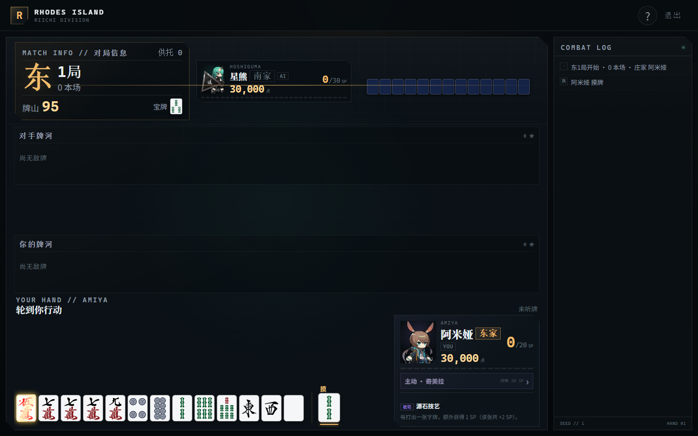
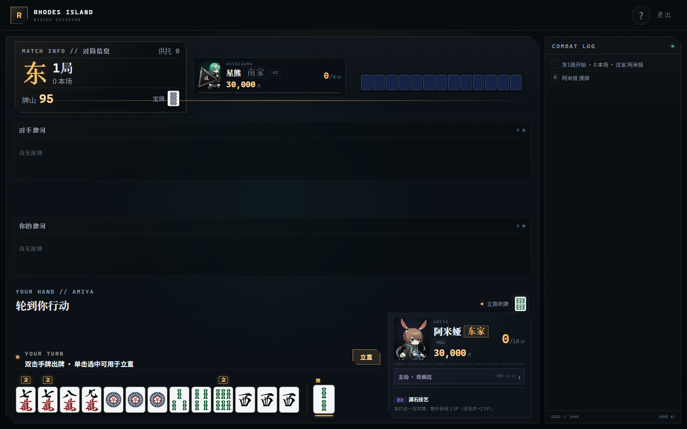
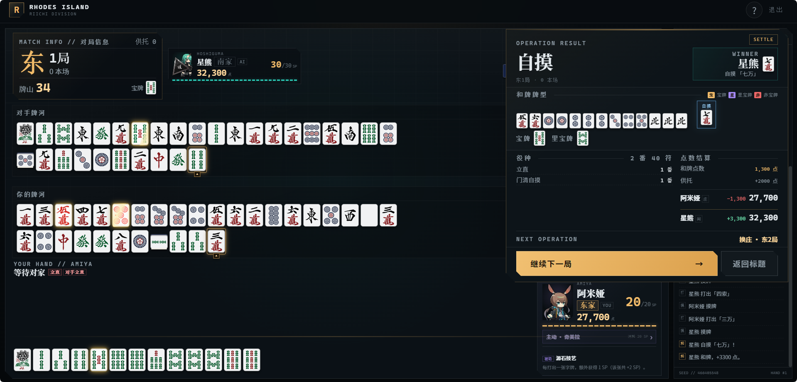
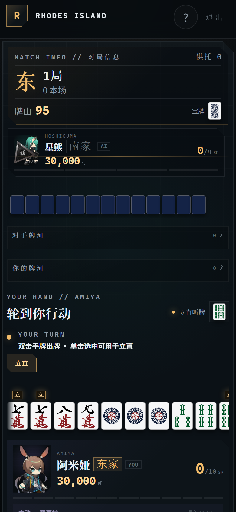

# 明日雀庄 · 双人立直麻将

《明日方舟》主题的 **2 人日本立直麻将网页单机版**。玩家扮演阿米娅或星熊，与另一位干员进行东风场、南风场半庄战。核心特色是每位干员 **1 个主动技能 + 1 个被动技能**，并带有一整套可复现的日麻规则引擎。

> 同人练习作品，非商业用途。干员立绘与麻将牌面来自项目内素材目录，立绘已裁掉透明留白；后续可直接替换正式素材。
> 麻将素材来源：https://github.com/liang7758520/mahjong-tiles/tree/main
> 立绘素材来源：https://github.com/NagaMao/Arknights-PRTS-model

## 界面预览










---

## 快速开始

要求 Node.js 18+（推荐 20/22/24）。

```bash
npm install
npm run dev      # http://127.0.0.1:5173
npm test         # Vitest 规则 / 状态机 / AI 自对弈测试
npm run build    # TypeScript 严格检查 + 生产构建
npm run preview  # 预览生产包
```

---

## 本次优化重点

- 干员立绘使用 `src/prts_models` 中阿米娅、星熊的透明底 PNG，并裁掉留白后放入 `public/operators`。
- 麻将牌面使用 `src/mahjong_graphic-main/PNG 位图/扁平风格 flat style`；牌背为 `flat_back.png`；赤五使用 `f0m/f0p/f0s`；春夏秋冬梅兰竹菊不使用。
- 新增 3 张赤宝牌（赤五万 / 赤五筒 / 赤五索），和普通五视为同种牌参与听牌、振听、食替与悬停匹配，但和牌时额外 +1 番。
- 出牌方式改为 **双击手牌直接出牌**；单击只用于选中、预览立直听牌，不再有「出牌」按钮。
- 立直宣言牌在牌河中使用 `默认风格 default style/横 horizontal` 的横置牌图。
- 选角色卡片同时展示「主动技能 / 技能描述」和「被动技能 / 技能描述」。
- 牌桌当前对局信息（东/南x局、本场、牌山、宝牌）移到左上角；移除上一张舍牌与顶部点数条。
- 角色点数、东家/南家身份显示在角色信息卡内。
- 技能发动改为角色信息旁的气泡：我方在上方，对家在下方，并播放 Web Audio 提示音。
- 阿米娅技能改为 **非立直状态** 才能发动；检索牌替换本巡摸牌，本巡可正常和牌 / 立直，**本巡结束后** 才开始 3 巡摸切限制。
- 选中摸到的牌时，手中同种牌会一起高亮；悬停任意牌时，双方牌河中同种牌高亮（赤五与普通五互相匹配）。
- 吃 / 碰 / 杠 / 立直 / 自摸 / 荣和 / 九种九牌等按钮只在可用时显示，并移动到手牌旁；原底部操作条移除。
- 吃牌后的食替限制只在当前巡置灰，下巡自动解除；牌河中已鸣的牌不再置灰。
- 整体字号加大：对局内基础字号 19px，移动端 18px；东/南家座位徽章固定 18px，场风与局数使用更大的数字排版。
- 移除牌桌中央的「立直」徽章。
- 对局信息移到左上角，对家个人信息放在对局信息右侧；对家手牌在最右侧。
- 双方牌河每行最多 20 张，窄屏自动减少列数。
- 牌河牌面与手牌同为 42px 宽、4px 间距；宽屏每行 20 张。
- 手牌、牌河与鸣牌中的实际宝牌 / 赤宝牌带金色闪光动效；暗杠只有中间两张牌面闪光，两端牌背不闪。
- 结算弹窗改为紧凑排版：和牌人信息移到顶部右侧，删除独立 winner 横条，压缩役种与点数区间距；役种较多时底部按钮仍保持可见。
- 手牌区标题压缩为单行，删除独立的 STANDBY 状态框；牌河超过两行时自动扩展，极端长牌河下页面滚动而不是与手牌重叠。
- 星熊立直后不能发动力之锯。
- 立直后摸牌自动摸切；只有自摸、荣和、暗杠等需要确认时暂停。自摸 / 荣和按钮加大并带脉冲闪光。
- 副露手牌 hover 某张可听牌的舍牌时，显示「打这张听什么」的等待牌气泡。
- 鸣牌、和牌取消二次确认：碰、吃、杠、自摸、荣和点击后立即执行。
- 和牌结算新增完整手牌与副露展示，手牌 / 副露与和牌张分开排列，并逐张标记「宝」「里」「赤」；下方直接显示实际宝牌与里宝牌。
- 暗杠在鸣牌区按现实麻将显示为【牌背】【牌面】【牌面】【牌背】，不再四张全部牌背。
- 听牌、立直宣言预览中等待和的牌改为牌图展示，个人信息内的听牌提示也使用牌图。
- 立直交互重做：
  - 可立直时，手牌中的宣言牌上方显示「立」标记；
  - 点击「立直」后，只有宣言牌可点，其余手牌置灰；单击或悬停宣言牌可预览立直后的听牌，再次单击同一宣言牌即宣告立直；
  - 不点击「立直」而直接双击宣言牌则普通出牌（默听）；单击或悬停同样可预览立直听牌。
- 双方牌河改为上下排列，对手在上、我方在下，均从左到右；双方最新舍牌都有金色描边和「最新」标记。

---

## 已实现内容

### 阶段 1：核心麻将

- 136 张牌、可种子复现牌山；配牌 13 张、庄家先摸；王牌 14 张（岭上 4、宝牌指示 5、里宝指示 5）
- 完整摸打、吃 / 碰 / 明杠 / 暗杠 / 加杠、立直、一发、振听、食替禁止、抢杠
- 标准日麻役种：立直、两立直、一发、门清自摸、平和、断幺九、一杯口、二杯口、役牌、三色同顺、一气通贯、混全带、纯全带、对对和、三暗刻、三杠子、三色同刻、混老头、小三元、混一色、清一色、七对子、国士无双、四暗刻、大三元、小四喜、大四喜、字一色、清老头、绿一色、九莲宝灯、四杠子、天和、地和、海底 / 河底、岭上、抢杠等
- 标准符计算、满贯 / 跳满 / 倍满 / 三倍满 / 役满 / 累计役满、本场费、立直棒、场供、赤宝牌
- 流局听牌罚符 3000 点、九种九牌、四杠散了、流局满贯
- 连庄 / 换庄 / 本场 / 东风场→南风场 / 击飞 / 南四局结束按点数判定
- 2 人座次为 **东家 / 南家**：庄家为东家，闲家为南家；自摸只有对手一家支付

### 阶段 2：干员技能

**阿米娅**
- 被动「源石技艺」：打出字牌额外 +1 SP
- 主动「奇美拉」：20 SP，**仅非立直时** 可发动；检索指定牌并替换本巡摸牌，本巡可正常和牌 / 立直，本巡结束后 3 巡只能摸切，不可鸣牌 / 立直
- SP 上限 10，跨局保留，每局限一次

**星熊**
- 被动「荆棘」：自身支付点数时，和牌者将支付额的 10% 交入场供
- 主动「力之锯」：30 SP，本局对手和牌番数 −1（最低 1 番，役满不受影响），自身本局不可鸣牌；立直后不可发动

> **检索时点说明**：技能在「摸牌后、出牌前」发动。检索牌会立即替换本巡摸牌（原摸牌回到牌山顶部），保证检索牌确实在本巡入手；本巡操作不受限制，本巡结束才启动 3 巡摸切代价。

### 阶段 3：AI 与 UI

- AI 使用公开信息 + 自己手牌，不读取玩家手牌或牌山；阿米娅检索时仅校验目标是否仍在牌山
- 和牌必和、听牌防守、现物优先、向断幺 / 役牌 / 混一色做牌、按进张与向听评分、役牌 / 断幺鸣牌、技能决策
- 明日方舟风格暗色工业 UI：干员立绘、图像化麻将牌、横置立直牌、技能气泡、SP 条、结算弹窗、响应式移动端
- 双击出牌、单击选中、同种牌联动选中、悬停牌河高亮、技能提示音

---

## 操作说明

- **双击手牌**：直接打出该牌。
- **单击手牌**：选中并预览立直听牌；立直宣言状态下再次单击同一宣言牌即宣告立直。
- 手牌旁的按钮会按当前可用操作动态出现：立直、自摸、暗杠、加杠、九种九牌、荣和、碰、杠、吃、过。
- 鸣牌、和牌点击后立即执行，不再弹出二次确认；暗杠 / 加杠有多个候选时仍会弹出选牌框。
- 听牌与立直预览中的等待牌使用牌图显示；和牌结算会展示完整手牌与副露，并标注宝牌 / 里宝牌 / 赤宝牌。和牌结算固定显示在牌河右侧，不模糊背景，左侧牌河与手牌仍然可见。
- 暗杠的鸣牌区显示为【牌背】【牌面】【牌面】【牌背】。
- **立直操作**：
  1. 可立直时，宣言牌上方有「立」标记。
  2. 点击「立直」进入宣言状态，非宣言牌置灰且不可点击。
  3. 单击或悬停宣言牌查看立直后的听牌；再次单击同一宣言牌宣告立直。
  4. 若直接双击宣言牌，则普通出牌（默听）；单击 / 悬停仍可预览听牌。
- 吃牌有多个组合时会弹出选择框。
- 食替限制只持续当前巡，下巡自动恢复。
- 悬停任意手牌或牌河牌，双方牌河中同种牌会高亮；赤五与普通五视为同种。
- 技能按钮在角色信息卡内，SP 满且当前可发动时亮起。
- 双方最新舍牌有金色描边和「最新」标签。
- 手牌、牌河、鸣牌中的宝牌与赤宝牌会以金色闪光提示；暗杠只有翻开的中间两张牌面闪光。

---

## 规则实现备注（2 人调整）

- 起始点数双方 30000；东 1 局玩家先庄。
- 庄家和牌或流局听牌 → 连庄，本场 +1；否则换庄、本场清零。
- 和牌每本场 +300 点；立直棒与场供归和牌者。
- 流局时仅一方听牌，听牌者收 3000 点；双方听牌 / 双方未听无罚符。
- 自摸：仅对手支付，庄 / 闲均为 base × 2；荣和：闲家 base × 4，庄家 base × 6。
- 九种九牌与四杠散了按简化处理：不支付听牌罚符，庄家连庄。
- 食替规则：鸣牌后不能打出被鸣的牌，也不能打出会与手中搭子重新组成同一顺子的替换牌。
- 立直后仅允许不改变听牌形的暗杠；不可加杠。
- 赤五共 3 张（万 / 筒 / 索各一），红五与普通五同种，和牌 +1 番；无其他赤宝牌。
- 无一炮双响（2 人仅一家）；最多 4 次杠。
- 大三元 / 大四喜的包牌责任会被记录并在结算中标记；2 人局只有一家支付，因此责任支付者与通常支付者天然重合。

---

## 素材位置

- 干员原图：`src/prts_models/char_002_amiya__...png`、`char_136_hsguma__...png`
- 使用中的立绘：`public/operators/amiya.png`、`public/operators/hoshiguma.png`
- 扁平牌面：`src/mahjong_graphic-main/PNG 位图/扁平风格 flat style/`
- 使用中的牌面与牌背：`public/tiles/flat/`
- 横置牌：`src/mahjong_graphic-main/PNG 位图/默认风格 default style/横 horizontal/`
- 使用中的横置牌：`public/tiles/horizontal/`

---

## 项目结构

```text
src/
  game/
    tiles.ts      牌定义、种子随机、牌山、赤五
    types.ts      全局类型
    rules.ts      和牌结构、役种、符、向听、听牌
    scoring.ts    点数与满贯界限
    state.ts      对局状态机、鸣牌、立直、振听、流局、结算
    skills.ts     干员技能、SP、技能校验
    ai.ts         简单 AI 决策
  ui/
    Table.tsx / Hand.tsx / River.tsx / SkillBar.tsx ...
    StartScreen.tsx / ResultModal.tsx / Modals.tsx
    Tile.tsx / tileAssets.ts / operatorAssets.ts / sound.ts
  tests/
    rules.test.ts
    state.test.ts
    simulation.test.ts
public/
  operators/      干员立绘
  tiles/flat/     扁平牌面
  tiles/horizontal/ 横置立直牌
```

游戏逻辑与 React 完全解耦：`src/game` 不依赖 DOM/UI，所有操作均为纯函数式状态转换，并支持种子复现。

---

## 测试

当前覆盖：

- 牌山固定张数、种子一致性、宝牌循环、赤五张数与同种匹配
- 标准和牌 / 七对子 / 国士 / 听牌 / 向听
- 平和、断幺、役牌、三色、一气、全带、对对、三暗刻、小三元、大三元、四暗刻、混一色、清一色、天和、赤宝牌等
- 符计算、满贯界限、2 人麻将支付
- 立直支付、SP 获取与上限、SP 跨局保留
- 阿米娅检索 / 非立直限制 / 本巡不受限 / 后续 3 巡限制、星熊减番 / 禁鸣 / 被动场供
- 振听、食替、食替解除、流局听牌罚符、下一局状态继承
- 立直宣言牌听牌预览、赤五、食替解除
- AI 自对弈多局冒烟测试与点数守恒断言

```text
Test Files  3 passed
Tests      51 passed
```

---

## 后续可扩展

- 剧情模式、更多干员技能、技能升级 / 多次主动
- 3 / 4 人麻将与联机
- 正式立绘、语音、牌桌动画、音效
- 牌谱保存 / 回放 / 详细 AI 难度分级


